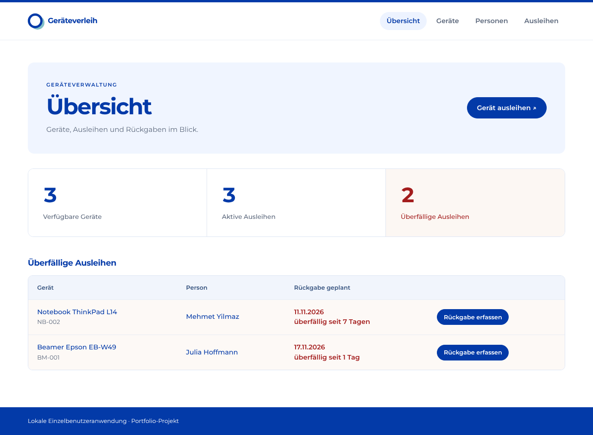
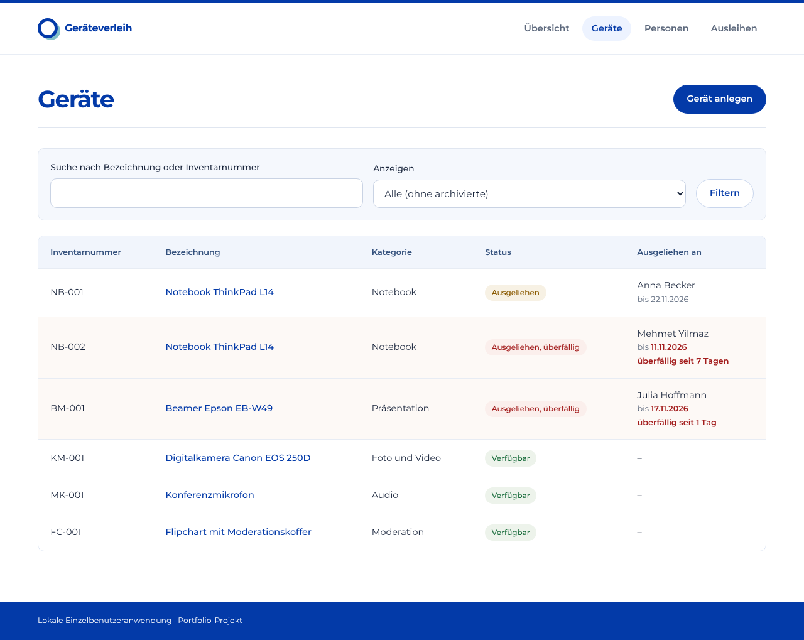

# Geräteverleih

Kleine Webanwendung, mit der eine Organisation nachvollziehen kann, welche Geräte verfügbar sind, wer ein Gerät ausgeliehen hat und wann es zurückgegeben werden soll.

Das Projekt entstand als Portfolio-Projekt während meiner Umschulung zum Fachinformatiker für Anwendungsentwicklung. Der Schwerpunkt liegt auf sauberen Geschäftsregeln, Datenbanksicherung und Tests, nicht auf einem großen Funktionsumfang.

**Live-Demo:** https://ario-mi.github.io/geraeteverleih/ (statisch, mit erfundenen Beispieldaten)

## Vorschau





## Technik

Python 3.11+, Flask, SQLAlchemy, SQLite, Jinja2 und pytest. Die Oberfläche ist responsiv und verwendet lokal ausgeliefertes CSS ohne Frontend-Build.

## Problem und Nutzen

In kleinen Teams werden Geräte (Notebooks, Beamer, Kameras) oft per Zuruf oder Excel-Liste verliehen. Dann fehlt der Überblick: Wer hat das Gerät? Ist es noch frei? Ist die Rückgabe überfällig? Die Anwendung beantwortet diese Fragen auf einen Blick und verhindert, dass ein Gerät doppelt vergeben wird.

## Funktionsumfang

- **Geräte** anlegen, anzeigen, bearbeiten und archivieren (Inventarnummer, Bezeichnung, Kategorie, optionale Beschreibung). Archivierte Geräte sind nicht mehr ausleihbar, ihre Historie bleibt erhalten.
- **Personen** anlegen und bearbeiten (Name, optionale E-Mail-Adresse). Pro Person werden die aktuell ausgeliehenen Geräte angezeigt.
- **Ausleihe** mit Ausleihdatum und geplantem Rückgabedatum. Ein Gerät hat höchstens eine aktive Ausleihe.
- **Rückgabe** erfassen. Das Gerät ist danach wieder verfügbar, die Historie bleibt bestehen. Mehrfaches Absenden ändert nichts.
- **Übersicht** mit Anzahl verfügbarer Geräte, aktiver und überfälliger Ausleihen. Überfällige Ausleihen sind durch Text und Farbe hervorgehoben.
- **Suche und Filter** nach Bezeichnung oder Inventarnummer sowie nach verfügbar, ausgeliehen und archiviert.

## Installation (Windows PowerShell)

Voraussetzung: Python 3.11 oder neuer.

```powershell
cd geraeteverleih
python -m venv .venv
.\.venv\Scripts\Activate.ps1
python -m pip install -r requirements.txt
```

Falls PowerShell das Aktivieren blockiert, einmalig in der aktuellen Sitzung erlauben:

```powershell
Set-ExecutionPolicy -Scope Process -ExecutionPolicy Bypass
```

## Datenbank, Beispieldaten, Start und Tests

```powershell
# Tabellen anlegen (die Datei liegt in instance\geraeteverleih.db)
python -m flask --app app init-db

# Optional: erfundene Beispieldaten laden (mehrfaches Ausführen erzeugt keine Duplikate)
python -m flask --app app seed-demo

# Anwendung starten, danach http://127.0.0.1:5000 öffnen
python -m flask --app app run --debug

# Automatisierte Tests ausführen
python -m pytest
```

Optionale Umgebungsvariablen: `DATABASE_URL` (andere Datenbank) und `SECRET_KEY` (für den Serverbetrieb zwingend setzen).

## Projektstruktur

```
app/
  __init__.py      App-Factory create_app()
  config.py        Konfiguration
  extensions.py    db und CSRF-Schutz, SQLite-Fremdschlüssel einschalten
  models.py        Datenmodell
  services.py      Geschäftsregeln und Datenbankabfragen
  parsing.py       Formulartexte in Zahlen und Datumswerte umwandeln
  seed.py, cli.py  Beispieldaten und die Befehle init-db und seed-demo
  views/           Flask-Routen (Blueprints für Übersicht, Geräte, Personen, Ausleihen)
  templates/       Jinja2-Templates, static/style.css
scripts/build_demo.py  Statische Demo für GitHub Pages erzeugen
tests/             pytest-Tests mit isolierter Testdatenbank
```

Die Routen lesen nur Formulardaten und rufen Funktionen aus `services.py` auf. Dort liegen alle Regeln, dadurch lassen sie sich ohne Browser testen.

## Datenmodell

| Tabelle | Wichtige Spalten |
| --- | --- |
| `devices` | `inventory_number` (eindeutig), `name`, `category`, `description`, `is_archived` |
| `persons` | `name`, `email` (optional) |
| `loans` | `device_id`, `person_id`, `loan_date`, `due_date`, `returned_date` (leer = aktiv) |

Eine Person kann viele Ausleihen haben, ein Gerät ebenfalls (Historie). Eine Ausleihe gehört genau zu einem Gerät und einer Person.

## Wichtige technische Entscheidungen

- **Verfügbarkeit wird berechnet, nicht gespeichert.** Ein Gerät ist ausgeliehen, solange es eine Ausleihe ohne `returned_date` gibt. Es gibt kein Statusfeld, das von den Ausleihen abweichen könnte.
- **Doppelte Ausleihe auf Datenbankebene verhindert.** Ein partieller eindeutiger Index (`device_id` nur für Zeilen mit `returned_date IS NULL`) erlaubt höchstens eine aktive Ausleihe pro Gerät. Die Anwendung prüft vorab für eine verständliche Meldung. Bei gleichzeitigen Anfragen entscheidet der Index, der unterlegene Vorgang wird zurückgerollt und der Person wird ein Konflikt gemeldet.
- **Datumsregeln auch als CHECK-Constraint.** Rückgabe und geplante Rückgabe dürfen nicht vor der Ausleihe liegen.
- **Rückgabe ist idempotent.** Die Rückgabe ist ein bedingtes `UPDATE ... WHERE returned_date IS NULL`. Wer zuerst kommt, setzt das Datum, weitere Anfragen ändern nichts und erhalten einen Hinweis.
- **Transaktionen mit Rollback.** Änderungen werden mit einem `commit` gespeichert. Bei einem `IntegrityError` folgt `rollback`, danach eine Meldung.
- **CSRF-Schutz** über Flask-WTF in allen Formularen. Änderungen laufen ausschließlich über POST, GET-Anfragen verändern keine Daten.
- **Geräte werden archiviert statt gelöscht**, damit die Ausleihhistorie vollständig bleibt. Ein ausgeliehenes Gerät kann erst nach der Rückgabe archiviert werden. Archivierte Geräte lassen sich wieder aktivieren.
- **Überfällig** bedeutet: geplantes Rückgabedatum liegt vor dem heutigen Datum und es gibt noch keine Rückgabe. Eine Rückgabe am geplanten Tag selbst ist noch rechtzeitig.
- **Tests** laufen gegen eine eigene SQLite-Datei in einem temporären Ordner, die echte Datenbank bleibt unberührt.

## Grenzen der lokalen Einzelbenutzerversion

- Keine Anmeldung und keine Rollen: Jede Person mit Zugriff auf die Anwendung darf alles.
- SQLite und der Flask-Entwicklungsserver sind für einen Nutzer oder kleine Teams im lokalen Netz gedacht, nicht für den öffentlichen Betrieb.
- Keine Datenbankmigrationen: Änderungen am Datenmodell erfordern ein neues Anlegen der Datenbank (`instance\geraeteverleih.db` löschen und `init-db` erneut ausführen).
- Keine E-Mail-Erinnerungen bei Überfälligkeit, kein Export, keine Löschfunktion für Personen.
- Das Archivieren eines Geräts und eine gleichzeitige neue Ausleihe sind nicht gegeneinander abgesichert. Die Absicherung gilt der doppelten Ausleihe.
- Die Suche unterscheidet bei Umlauten zwischen Groß- und Kleinschreibung (SQLite-Verhalten).


## Tests und GitHub Actions

```powershell
python -m pytest -v
```

Die Tests decken unter anderem Geräte und Personen, Ausleihen, Rückgaben, Datumsvalidierung, Datenbank-Constraints, CSRF und die Weboberfläche ab. GitHub Actions führt sie bei Pushes und Pull Requests mit Python 3.11 bis 3.14 aus.

## Manuell ausprobieren

1. Mit `init-db` und `seed-demo` eine lokale Datenbank mit erfundenen Beispieldaten vorbereiten.
2. Anwendung starten und `http://127.0.0.1:5000` aufrufen.
3. Ein Gerät und eine Person anlegen und das Gerät ausleihen.
4. Eine zweite aktive Ausleihe desselben Geräts versuchen: Sie wird abgelehnt.
5. Die Rückgabe erfassen: Das Gerät ist wieder verfügbar.
6. Das Gerät archivieren: Es kann danach nicht ausgeliehen werden.

## Statische Demo auf GitHub Pages

GitHub Pages kann kein Python ausführen. Deshalb erzeugt `scripts/build_demo.py` die Demo: Das Skript startet die Anwendung mit einer temporären SQLite-Datenbank und den Beispieldaten aus `seed-demo`, ruft alle erreichbaren Seiten über den Flask-Testclient ab und speichert sie als HTML-Dateien. Interne Links werden dabei auf die erzeugten Dateien umgeschrieben.

In der Demo sind Formulare deaktiviert, es wird nichts gespeichert. Der Statusfilter der Geräteliste funktioniert, die Textsuche nur in der Vollversion. GitHub Actions (`.github/workflows/pages.yml`) führt zuerst die Tests aus und veröffentlicht die Demo dann bei jedem Push auf `main` sowie einmal pro Woche neu, damit Fristen und überfällige Ausleihen zum aktuellen Datum passen.

Lokal erzeugen (Ausgabe im Ordner `demo/`):

```powershell
python scripts/build_demo.py
```

## Lokale Dateien

Datenbanken im Verzeichnis `instance/`, virtuelle Umgebungen, Cache-Dateien und `.env`-Dateien werden über `.gitignore` ausgeschlossen. Beispieldaten werden mit `seed-demo` erzeugt und nicht als Datenbankdatei eingecheckt.
